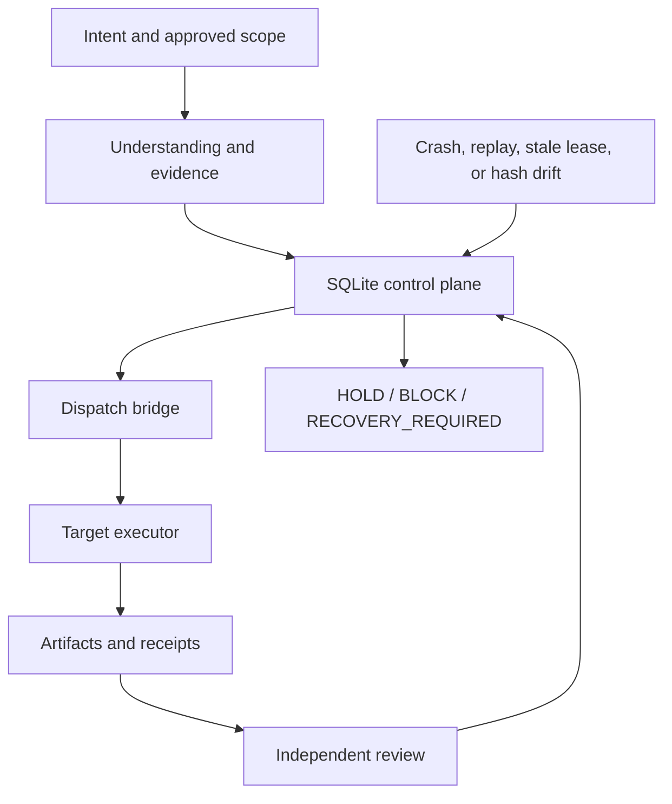

# Optimismus Prime

## A deterministic control plane for AI agents

Optimismus Prime is a Python control plane for local AI agents that need
auditable state transitions, safe dispatch, crash recovery, and independently
verifiable results.

I built it for the part of AI engineering that starts after the model produces
an answer: deciding what may happen next, who owns the transition, whether the
state is still current, and how to prove the result after a failure.

## Why it matters

Language models are excellent proposal engines. They are not authoritative
state machines. Optimismus Prime turns agent execution into explicit contracts:

- Which source snapshot was observed?
- Which worker owns the next transition?
- Is the queue state still current?
- Was the worker admitted and acknowledged?
- Can a stale or replayed writer mutate state?
- Can another process independently verify the resulting artifact?

## Architecture



## Core guarantees

| Capability | Implementation |
|---|---|
| Authoritative state | SQLite-backed state with compare-and-swap transitions |
| Ownership | Monotonic leases and fencing tokens prevent stale writers |
| Evidence | Source attestations, receipts, manifests, and verifiable artifacts |
| Recovery | Durable transaction markers, replay ownership, and bounded recovery |
| Safety | Fail-closed path policy, scope checks, and explicit HOLD/BLOCK outcomes |
| Verification | Deterministic fault-injection and adversarial W5 test harnesses |

The repository models sixteen layers, L0 through L15, covering scope,
provenance, ingestion, context, planning, scheduling, agent admission,
execution boundaries, artifacts, review, and acceptance evidence.

The implementation combines POSIX-shell operator paths, Python contract and
verification modules, SQLite state, JSON/JSONL evidence, and narrow MCP write
boundaries.

## Quickstart

Python 3.11 or newer is supported.

```bash
python3 -m venv .venv
source .venv/bin/activate
python3 -m pip install 'pytest>=8,<9'
python3 -m pytest -q -p no:cacheprovider
```

The suite is self-contained: tests use temporary directories and SQLite
databases and require no model server, credentials, privileged service, or
external project checkout.

## Repository map

| Path | Responsibility |
|---|---|
| `modules/mother-control-plane/` | SQLite control-plane proof harness |
| `modules/understanding_s0`–`s3/` | Registry, scanning, verification, events, and context bundles |
| `modules/w4_small_loop_s0/` | Authority, review preparation, and tool-circuit verification |
| `modules/w5_dispatch_bridge_s0/` | Dispatch evidence, queue writes, receipts, replay, and recovery |
| `mcp/prime_policy.py` | Narrow fail-closed policy boundary |
| `mcp/prime_writes.py` | Explicit write boundary |
| `docs/` | Architecture, security model, state machine, and verification map |
| `tests/` | Contract, adversarial, fault-injection, and reproducibility tests |

## Engineering themes

- **CAS is mandatory:** mutations require the digest of the latest observed
  state.
- **Leases are fenced:** owner identity, epoch, token, and expiry are checked
  before mutation.
- **Prepare precedes replacement:** crash recovery is explicit and idempotent.
- **Replay is modeled:** identical idempotency intents can replay; conflicting
  intents are held.
- **Review is independent:** transport completion and artifact creation do not
  imply semantic acceptance.

Host executors, model servers, credentials, and runtime databases are
integration inputs. The repository keeps the control-plane implementation and
its verification harness reproducible and reviewable.

## License

MIT. See [`LICENSE`](LICENSE).
