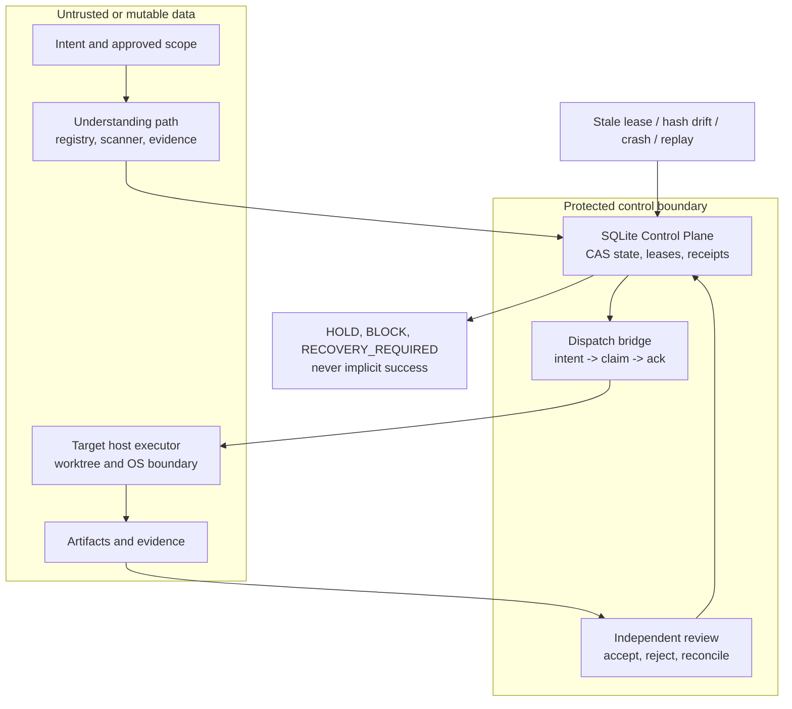

# Optimismus Prime

Optimismus Prime is a deterministic, evidence-bound control plane for local AI agent execution. It turns multi-step work into explicit state transitions, fenced dispatch decisions, durable receipts, and independently verifiable recovery paths.

The public snapshot focuses on the contract surface: SQLite-backed runtime state, compare-and-swap transitions, monotonic lease fencing, fail-closed path policy, deterministic evidence, and adversarial W5 verification harnesses.

## Why it exists

Language models are good at proposing actions but are not authoritative state machines. A reliable agent system must answer, in code and after a crash:

- Which source snapshot was observed?
- Who owns the next transition?
- Is this queue state still current?
- Was a worker actually admitted and acknowledged?
- Can a stale or replayed writer mutate state?
- Is the resulting artifact independently verifiable?

Prime treats those questions as contracts rather than prompt conventions.

## Architecture

The diagram shows the control flow and the intended host execution boundary.
The exported SQLite harness exercises dispatch, acknowledgements and recovery
with a deterministic in-memory executor.



The normative model contains sixteen layers, L0 through L15. The current release implements and tests the deterministic foundation through the W5 dispatch and recovery contracts:

| Layer group | Responsibility |
| --- | --- |
| L0–L2 | scope, provenance, project and path policy |
| L3–L7 | ingestion, runtime events, typed knowledge, retrieval and context |
| L8–L11 | work units, discovery, immutable plans and deterministic scheduling |
| L12–L13 | Mother control state and capability-bound agent admission |
| L14 | sandbox and execution boundary |
| L15 | artifacts, receipts, review and acceptance evidence |

Implementation map:

- `modules/mother-control-plane/` — isolated SQLite control-plane proof harness
- `modules/understanding_s0` … `understanding_s3` — read-only registry, scanning, verification, events and context bundles
- `modules/w4_small_loop_s0/` — authority, review preparation and tool-circuit verification
- `modules/w5_dispatch_bridge_s0/` — dispatch evidence, queue writer, replay ownership, receipt journaling and bounded recovery
- `mcp/prime_policy.py` and `mcp/prime_writes.py` — narrow, fail-closed mutation boundary

See the [architecture](docs/architecture.md), [security model](docs/security-model.md),
[state machine](docs/state-machine.md) and [verification map](docs/verification.md)
for the boundaries and test coverage of the export.

## Quick verification

From the export root, use Python 3.11 or newer to prepare a virtual
environment and install the declared pytest version.

```bash
python3 -m venv .venv
source .venv/bin/activate
python3 -m pip install 'pytest>=8,<9'
```

Run the suite in the activated environment.

```bash
python3 -m pytest -q -p no:cacheprovider
```

Expected result: `1180 passed`.

The suite is self-contained: tests use temporary directories and SQLite databases and require no model server, network connection, credentials, or external project checkout.

## Design decisions

- **SQLite is the runtime authority.** `QUEUE.json` can be a versioned source or projection; it is not a second state authority.
- **CAS is mandatory.** Mutations require the SHA-256 of the most recently observed queue or state.
- **Leases are fenced monotonically.** Owner identity, epoch, fencing token and expiry are checked before mutation.
- **Prepare precedes replacement.** Durable transaction markers make crash recovery explicit and idempotent.
- **Replay is a first-class outcome.** An identical idempotency intent can be replayed; a conflicting intent is held.
- **Validation fails closed.** Path traversal, symlinks, stale evidence, scope drift and missing receipts produce HOLD, BLOCK or RECOVERY_REQUIRED.
- **Review is independent.** Transport completion and artifact creation do not imply semantic acceptance.
- **The test harness is deterministic.** Fault injection covers crash points, queue drift, stale ownership, replay, quarantine and recovery eligibility.

## Repository scope

This repository intentionally excludes host-specific adapters, runtime logs, private project registries, generated databases, model artifacts and historical Git metadata. The result is a small architecture-and-verification showcase that can be run locally without privileged services.

## License

MIT. See [`LICENSE`](LICENSE).
